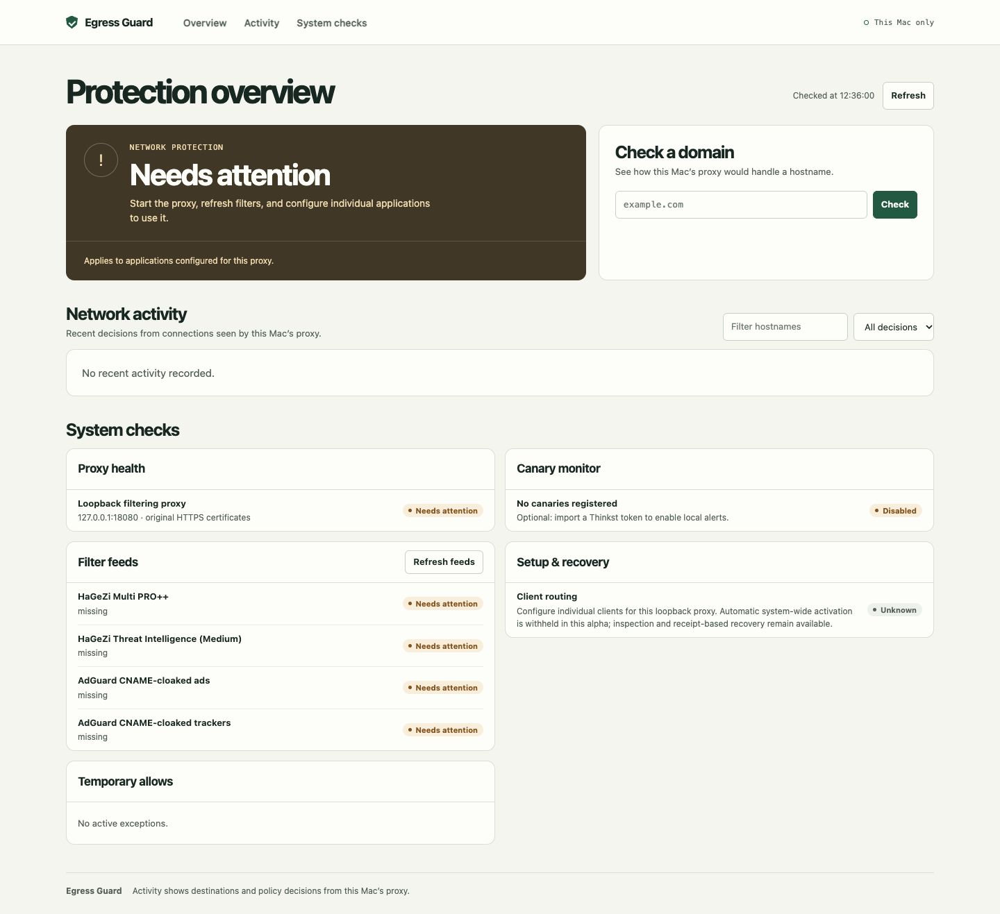

# Egress Guard

Local ad, tracker and threat filtering for macOS, with a portable Python core.

Egress Guard runs a loopback proxy and a private control dashboard. HTTPS keeps the origin server's certificate and encrypted contents. No root daemon, browser certificate trust, or account credentials are needed for filtering.

**0.10.0 is alpha software.** This revision recognizes documented tracking protocols behind first-party URLs, rechecks permissions while an opaque proxy tunnel is carrying data, and removes known PostHog identity headers in named-site Isolation. New configurations retain no domain history by default. Read the [0.10 changes, measured comparison and qualification limits](docs/release-0.10.md).

The transport was previously exercised on macOS ARM64 with Python 3.12. The new transport work is qualified through isolated Linux tests and real loopback TLS fixtures; the experimental address guard requires a supported CPython selector loop and a successful startup self-test. Chrome's actual rule/setting APIs, macOS launchd, installed-browser native messaging and the local model still require target-device qualification. Windows dashboard authentication and verified health remain unavailable until a private ACL-backed identity store is implemented. Guided setup and native canary notifications are macOS features.

## What it does

- Blocks domains from HaGeZi's ad/tracker and full threat-intelligence feeds, URLhaus malware hosts and IP addresses, Phishing Army phishing domains and curated, exact-match AdGuard CNAME aliases. Threat matches cannot be overridden by allow rules, exemptions, pauses or timed exceptions.
- Blocks known DNS-over-HTTPS servers by name and the major public resolvers by address, and punycode look-alikes of well-known brands (for example `xn--pple-43d.com`, which displays as "аpple.com" with a Cyrillic "а"). A short, built-in list of exact sign-in, OS-update and certificate-revocation hosts for Apple, Google, Microsoft, DigiCert and Mozilla bypasses downloaded hostname lists. With the experimental address guard enabled, an independently blocked resolved IP still wins. [Every block reason](#block-reasons).
- Inspects additional CNAME chains through the macOS system resolver on explicit request, with portable offline analysis and separate policy results for each alias. Conflicting or incomplete answers remain indeterminate.
- Fetches community sponsor-timing suggestions by a short video hash prefix on explicit request, checks the supplied current duration, and exports attributed local JSON for manual review.
- Updates feeds daily when macOS background services are enabled. Invalid, truncated or failed downloads retain the last good copy; the dashboard shows publication age separately from download success.
- Refuses external plaintext HTTP requests carrying `Cookie` or `Authorization` headers before forwarding them, and closes a CONNECT tunnel to an external host unless its first bytes are a complete TLS ClientHello, so plaintext cannot travel through a tunnel unchecked. Other protocols over CONNECT, such as SSH, need `block_plaintext_credentials = false`. This is a guard against accidental plaintext credentials, not data-loss prevention: it reads only those two headers, never inspects encrypted traffic, and cannot stop a program that deliberately sends data elsewhere.
- Checks an initial TLS ClientHello's visible server name independently of the CONNECT destination, including IP-address tunnels. Both must pass the current policy before upstream contact; a grant for one name does not permit another. Original TLS bytes and certificates are preserved. ECH-hidden names and later encrypted requests remain opaque. [Transport behavior and tests](docs/core-0.8.md).
- Offers an explicit hardened transport profile that refuses external plaintext HTTP before forwarding a body, refuses non-loopback literal CONNECT targets, and restricts CONNECT ports. The independent experimental address guard checks each actual numeric TCP connection candidate against current IP policy without a second DNS lookup; a rejected address can fall back to an allowed candidate. [Configuration and qualification](docs/core-0.9.md).
- Rechecks an admitted CONNECT tunnel's original authority, initial visible TLS name and current transport policy before forwarding either direction. Revoked permissions, expired grants and new denies stop later forwarding. With the address guard selected, current IP policy also applies to the connected peer. Data already forwarded cannot be recalled. [Live-tunnel boundary](docs/core-0.10.md).
- Provides an authenticated local dashboard with decision explanations, temporary exact-host exceptions, ad-filter pauses, manual rules and local activity.
- Adds an optional Chrome 145+ companion for request-level filtering, indexed generic and scoped cosmetic rules, deterministic sponsored-card hiding and user-reviewed local model suggestions. Default Strict holds scripts, frames, fonts and objects until a site's complete policy is installed. Its popup distinguishes saved policy from applied policy and reports incomplete coverage. [Build, recovery and compatibility costs](docs/browser-companion.md).
- Compiles source-backed tracking-protocol signatures into the Chrome companion. Exact query keys, values, methods and resource types recognize supported collection and loader formats even when parameter order or endpoint names change. Encrypted/body-only payloads and arbitrary protocol rewrites retain explicit limits. [Source analysis and signatures](docs/tracking-protocols-0.10.md).
- Adds an Isolated mode for a named browser site: new cross-site subresource requests are blocked across the covered page context, including images, fetches and socket handshakes, while HTTP identity headers are removed on site resources and navigations to that site. Ordinary grants and Pause cannot relax isolation. Existing connections, local site storage, outbound navigations and public IP exposure retain explicit limits. [Enforcement design](docs/enforcement-0.9.md).
- Imports AdGuard/uBO URL Tracking Protection at browser build time. Network and click-time parameter cleaning share a bounded policy, source exceptions also narrow overlapping built-ins, and signed/authentication links are preserved. Unsupported source forms are counted and unsafe exception fallbacks reduce the build receipt. [Compiler behavior](docs/parameters-0.9.md).
- Offers optional Chrome profile controls for speculative loading, non-proxied WebRTC UDP, third-party cookies, browser advertising APIs and selected remote browser services. Each control shows its actual value and owner. Explicit release removes only Egress Guard's override. [Controls and tradeoffs](docs/browser-privacy-0.8.md).
- Offers an explicitly registered, read-only native messaging bridge so the Chrome popup can check the local proxy's authenticated policy, transport and logging acknowledgments. It cannot change routing, weaken rules or prove device-wide coverage.
- Monitors canaries you explicitly register with Thinkst and sends batched macOS notifications. Registration verifies access and establishes a history baseline without exposing token values in logs or the dashboard.
- Leaves system-wide routing unchanged. Automatic native activation is withheld until endpoint ownership can be guaranteed across logout, crashes and reboot. Inspection and ownership-preserving recovery are retained.

## Install on macOS

Requirements: Python 3.12 or newer, an ordinary macOS account, and Internet access to install the pinned transport and download filter data. Do not run the installer with `sudo`.

1. Download the source archive and `SHA256SUMS` from [Releases](https://github.com/SulaymanB2024/egress-guard/releases). Check the archive with `shasum -a 256`, then extract it.
2. From the extracted directory, run:

```sh
sh scripts/install-macos.sh
```

The installer creates a private virtual environment, installs hash-checked dependencies and prints its command path. It changes no proxy settings. If your default Python is older, select a suitable interpreter with `EGRESS_GUARD_PYTHON=/path/to/python3.12`. Dependency wheels must be available for your interpreter/platform; setup stops rather than compiling unreviewed dependency source. See [dependency locks and open upstream advisories](requirements/README.md).

```sh
EG="$HOME/Library/Application Support/Egress Guard/venv/bin/egress-guard"
"$EG" init
"$EG" refresh
"$EG" start
"$EG" open
```

The dashboard opens on this machine only. Configure individual proxy-aware applications for `http://127.0.0.1:18080`. For example:

```sh
curl --proxy http://127.0.0.1:18080 https://example.com/
```

You can inspect existing system routing without changing it:

```sh
/usr/sbin/networksetup -listallnetworkservices
"$EG" proxy inspect --service "Wi-Fi"
```

This alpha does not enable a persistent machine-wide proxy. A per-user process cannot reserve an unprivileged port after its login session ends, while a network service's proxy setting may survive. On a Mac with untrusted local accounts, do not rely on an unattended unprivileged listener as a persistent routing endpoint.

## Restore or stop

```sh
"$EG" proxy restore
"$EG" stop
```

`stop` restores any pre-existing receipt-owned proxy settings before stopping its services. Recovery may require administrator approval; if declined or restoration fails, it leaves the proxy available. Logs and registrations are retained. A disabled proxy's dormant server fields may remain at loopback because macOS cannot rewrite those fields without briefly enabling that server; the result reports those fields.

For recovery without the CLI, turn off the matching `127.0.0.1:18080` HTTP and HTTPS settings for the affected service in macOS Network settings. Preserve any settings another application has since installed.

## Portable use

```sh
python -m pip install --require-hashes --only-binary=:all: --index-url https://pypi.org/simple -r requirements/runtime.lock
python -m pip install --no-deps --no-index ./egress_guard-0.10.0-py3-none-any.whl
python -m pip check
egress-guard init
egress-guard refresh
egress-guard run
```

Configure individual clients for `http://127.0.0.1:18080`. On macOS/Linux, run `egress-guard dashboard` in another terminal and `egress-guard open` to access controls. The dashboard uses port `18081` by default. A fresh install cannot start filtering with an empty or unverified feed cache. On Windows, `doctor` reports identity verification unavailable and the dashboard refuses to start; it never substitutes an unsigned readiness response.

Every enabled feed, including the CNAME feeds while `cname_protection = true`, must have a verified cache before filtering starts. The dashboard shows the saved policy revision next to the revision the proxy reports as applied. `egress-guard check host.example` reports `indeterminate` (exit code 2) instead of `allowed` while enabled feed coverage is incomplete.

After upgrading from 0.3, run `egress-guard refresh` once: the new malware, phishing and encrypted-DNS feeds must download before the proxy reports full readiness. Until the full HaGeZi threat feed arrives, the proxy keeps enforcing a verified medium-tier cache and reports the feed as degraded.

The default configuration exempts no hosts from tracker or CNAME decisions. To keep the Google Analytics, Microsoft Clarity and PostHog reporting consoles usable through the proxy, opt in with `exemption_presets = ["analytics-dashboards"]` under `[block]`, or list exact hosts in `dashboard_hosts`. Threat and manual block rules still apply to exempted hosts. Configurations created by earlier releases keep the six hosts they were written with in `dashboard_hosts`; set it to `[]` for the strict default.

Download the source archive for its `requirements` directory as well as the wheel. The source installer refuses an existing environment; this alpha has no automatic application-upgrade transaction. Existing users should keep their current installation intact until choosing a manual update plan.

### Stronger transport controls

The default `compatible` profile preserves the existing transport behavior. To select the stronger profile in your configuration:

```toml
[transport]
profile = "hardened"
connect_ports = [443]
address_guard = true
```

`hardened` blocks external plaintext HTTP, non-loopback IP CONNECT destinations and CONNECT ports outside the explicit list. Loopback health and local traffic remain available. HTTP-only services and services using unusual TLS ports can stop working; the proxy does not silently replay their requests over HTTPS. Ports must be unique, sorted integers, with at most 32 entries.

`address_guard` is a separate experimental setting, off by default, and needs a proxy restart after changing it. The process must pass its supported-runtime and socket self-test before reporting the guard active. When selected but unavailable, filtering traffic is refused and authenticated health still reports the reason. An active guard does not establish complete feeds or device-wide routing. Read [the address-guard lifecycle and limits](docs/core-0.9.md) before selecting it.

After upgrading to 0.10, restart the proxy before trusting its new receipts. The dashboard and native bridge require the running proxy to acknowledge `tunnel_policy: "per-forward"`; a still-running 0.9 process cannot satisfy readiness. Rebuild and reload the browser companion separately. Browser rule changes do not forcibly close established browser connections; proxy tunnel checks apply only to traffic actually carried through the restarted proxy.

## Block reasons

Each decision carries a `source` (stored in the activity log) and a `category` (shown by `egress-guard check` and the dashboard). `egress_guard.policy.CATEGORIES` maps every source to its category.

| Source | Category | Decision | Meaning | Can be overridden |
| --- | --- | --- | --- | --- |
| `malware-feed` | `malware` | blocked | URLhaus malware-distribution host or IP address | No |
| `phishing-feed` | `phishing` | blocked | Phishing Army domain | No |
| `threat-intel` | `threat` | blocked | HaGeZi Threat Intelligence (malware, scams, phishing, cryptojacking) | No |
| `lookalike-domain` | `lookalike` | blocked | Punycode label that spells a listed brand with look-alike letters | `allow` rules only |
| `local-block` | `manual` | blocked | Your `block.txt` or `hosts` rule | Remove the rule |
| `doh-feed` | `doh` | blocked | Encrypted DNS server (HaGeZi DoH list, or a public resolver address) | Allow rules, exemptions, timed exceptions; not the ad pause |
| `tracker-feed` | `ads-trackers` | blocked | HaGeZi Multi ad/tracker list | Yes |
| `cname-feed` | `cname-cloak` | blocked | Exact AdGuard CNAME-cloaked tracker alias | Yes |
| `safety-list` | `safety` | allowed | Built-in sign-in, update or revocation host | Your own block rule |
| `ip-literal` | `unfiltered` | allowed | Public IP address with no listed IP match; an initial visible TLS name receives a separate decision | — |
| `nonstandard-port` | `unfiltered` | allowed | Unlisted host on a port other than 80 or 443 | — |

Threat feeds are checked most specific first, so a host listed by both Phishing Army and HaGeZi is reported as `phishing-feed`. Other sources are unchanged from 0.3 (`no-match`, `local-allow`, `dashboard-exception`, `temporary-exception`, `tracker-paused`, `plaintext-credentials`, `non-tls-tunnel`, `invalid-host`).

Encrypted DNS is blocked by default because it can obscure the hostname a client subsequently uses through an IP-address tunnel. Initial visible TLS names receive a separate check, but absent or ECH-hidden names and later encrypted requests still limit visibility. Resolver fallback and compatibility depend on the client. Set `block_encrypted_dns = false` under `[block]` to allow DoH. In the compatible profile, unlisted raw IP addresses and unusual ports are labelled rather than blanket-blocked; listed malware IPs and resolver addresses are still blocked. Hardened transport adds the admission rules above. `threat_tier = "medium"` selects HaGeZi's smaller threat feed.

## Inspect disguised trackers and sponsor timings

`egress-guard cname-check www.example.com` reports the current system resolver's alias chain and each hostname's policy. It leaves live filtering unchanged. Use `--answers-file /path/to/observations.json` for portable, offline analysis. Exit code 2 means the report is indeterminate, including when verified filter data is unavailable. [Details and resolver privacy](docs/cname-inspection.md).

`egress-guard sponsor-fetch VIDEO_ID --duration SECONDS --output ./new-timings.json` explicitly asks SponsorBlock for community suggestions and atomically creates a new local file. It sends four hexadecimal hash characters and category filters; the provider still sees the connection and may identify the video from that prefix. Timings require manual review, and existing output files are preserved. No browser history is read and playback is unchanged. The optional browser companion is still under qualification. [Format, attribution and privacy](docs/sponsor-timings.md).

## Measure blocking

`EGRESS_GUARD_DATA=/path/to/refreshed-test-state PYTHONPATH=src python3 -B scripts/measure-coverage.py` reports entries per feed, entries no other enabled feed already covers, policy load time and memory, and decisions for the labelled public hostnames in `scripts/coverage-sample.txt`. It reads the local cache only. Use a temporary state directory, not a live installation.

## Dependency intelligence

Run `python3 -B scripts/audit-dependencies.py` from the source archive for an offline release inventory. Add `--online` to check those public package versions against OSV. This is an explicit maintenance check, not background telemetry. Four Tornado package advisories remain open under the transport's upstream version constraint; the affected web features are outside the shipped proxy/dashboard paths. [Scope, evidence and recovery status](requirements/README.md).

## Canary registration

Create a canary through [Thinkst Canarytokens](https://canarytokens.org/). Thinkst receives and stores trigger history. This application polls that history; it does not create provider accounts, change existing email/webhook settings, or provision cloud credentials automatically.

Import the management token, management auth value and a placement label as a JSON object through stdin:

```sh
egress-guard canary-import < /path/to/private-token.json
```

The JSON fields are `label`, `token`, `auth_token`, and optional `kind`. Keep this file private and outside repositories and backups. Do not put management credentials in command arguments. The dashboard service performs polling while logged in. Provider-side logging can delay AWS alerts; the Mac must be awake and online to display them.

## Coverage

Filtering applies to clients using this proxy. Existing encrypted tunnels, applications that bypass proxy settings, opaque UDP, and ads sharing a content origin need other controls. Browser cosmetic filtering remains useful: Chrome's [uBlock Origin Lite](https://github.com/uBlockOrigin/uBOL-home) and maintained Firefox/Brave protections provide capabilities outside a domain proxy. No certificate is installed or trusted. The transport may create unused private CA files inside its private configuration directory.

New configurations set `[logging] history = "none"`. Choose `aggregate` or `full` explicitly for local activity history; both use bounded buffering and retention. Existing saved choices are preserved on upgrade. Switching to `none` stops new traffic records after the writer acknowledges the change; it does not erase earlier records. Request paths, bodies, cookies, authorization values and canary management keys are excluded from the activity log. [Logging transitions and receipts](docs/core-0.7.md).

Read the [0.2.0 technical writeup](docs/technology-writeup.md), [architecture and threat model](docs/architecture.md), [security review and fixes](docs/security-review.md), [research and next steps](docs/research.md), [security policy](SECURITY.md), and [third-party notices](THIRD_PARTY_NOTICES.md).

## Dashboard

See the [390 px and 1440 px review](docs/dashboard-review.md). These first-run captures use empty, isolated state.



## Contribute

Read [CONTRIBUTING.md](CONTRIBUTING.md). Tests use temporary state and mocks for native settings. Do not run tests against a live installation or submit real credentials, traffic logs, private machine paths or generated feed caches.
