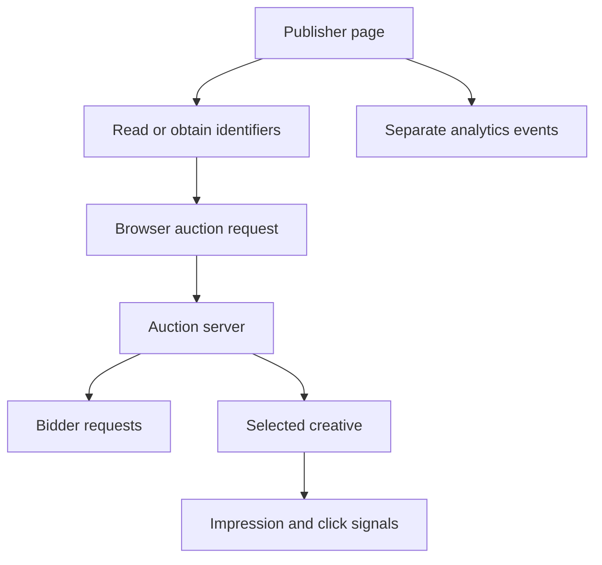

# Tracking and ad delivery: research behind 0.10

This work traced documented request formats and selected SDK source into concrete enforcement changes. It did not execute production tracking SDKs, send fabricated events to advertising services, read a person's browsing history, or obtain private vendor code. Source inspection and controlled transformations of documented formats are distinguished from captured production traffic.

The protocol catalog in [tracking-protocols-0.10.md](tracking-protocols-0.10.md) records supported signatures and source pins. The immutable challenge corpus is [protocols-v1.json](../tests/browser/fixtures/protocols-v1.json). [The release record](release-0.10.md) contains the measured result, artifacts and qualification limits.

The [public-source receipt](benchmarks/tracking-source-receipts-0.10.json) records eight inspected repositories and 37 files, with exact revisions, URLs and file hashes. The repository contains the receipts and original implementation; third-party SDK source is not bundled.

## What the advertiser receives, and when

Ad delivery is a sequence of opportunities to transmit data. A page may load an auction library, obtain or restore identifiers, call an auction service, load the selected creative and report impressions, clicks or conversions. Preventing only the final visible banner can leave the earlier requests intact. Conversely, preventing an auction request can remove the ad without eliminating a site's separate analytics.

Prebid's own endpoint documentation names the browser-facing auction and identity synchronization routes. Its synchronization design consolidates bidder-specific IDs into a cookie on the auction host, using image or iframe requests and redirects. Later auction calls can carry the matching bidder ID. OpenRTB defines separate exchange and buyer identifiers, and extended identity objects; the existence of several IDs does not mean the same user has several independent identities to the receiving systems. [Prebid endpoint contract](https://docs.prebid.org/prebid-server/endpoints/pbs-endpoint-overview.html), [synchronization sequence](https://docs.prebid.org/prebid-server/developers/pbs-cookie-sync), [OpenRTB User and Extended Identifier objects](https://github.com/InteractiveAdvertisingBureau/openrtb2.x/blob/main/2.6.md).

The browser extension can act on browser requests. A request that the publisher's server sends to a bidder after receiving an ordinary purchase or login is a separate connection on a different machine. Neither the local proxy nor the extension sees that connection. The useful local boundary is preventing unnecessary collection before the browser sends it, while recognizing that intentionally submitted application data reaches the application.

## The hostname is increasingly a weak discriminator

Google documents first-party server containers and several delivery methods, including image requests, fetch, XHR and a service worker running in an iframe. A rule for one hostname or one request type does not cover every documented transport. The collector can be the publisher's domain; some recognizable query fields can survive that change. [Google's delivery documentation](https://developers.google.com/tag-platform/tag-manager/server-side/send-data), [custom domains and same-origin hosting](https://developers.google.com/tag-platform/tag-manager/server-side/custom-domain).

PostHog goes further: its documented `rewriteRequestPath` option can replace collection, replay, configuration and asset paths while preserving the resolved origin and query. Its proxy instructions recommend neutral subdomain names because recognizable analytics names can be blocked. This is a documented product feature, not a hypothetical bypass. [Path rewriting](https://posthog.com/docs/libraries/js/config#customize-reverse-proxy-request-paths), [proxy deployment](https://posthog.com/docs/advanced/proxy).

Stape documents a same-origin loader and an optional encoding layer that removes the familiar GA4 URL pattern before the request reaches its server. An encoded route can remove the very features a deterministic URL classifier needs. The corpus includes a synthetic opaque case to represent that limit; it is not presented as a captured or decrypted Stape payload. [Encoding behavior](https://stape.io/helpdesk/knowledgebase/ga4-ad-block-bypass-in-custom-loader), [same-origin deployment](https://stape.io/helpdesk/documentation/how-to-use-same-origin-approach-for-server-gtm).

These observations suggest three different controls:

| Observable behavior | Appropriate control | Boundary |
| --- | --- | --- |
| Known independent tracker hostname | Maintained domain lists | New or shared publisher hosts need additional evidence. |
| Known protocol keys on a renamed publisher path | Anchored, source-backed protocol signatures | Exact encodings and tested formats only. |
| Opaque payload on an ordinary first-party API route | Restrict the application capability, or use an explicit reviewed endpoint rule | Guessing from an innocuous path cannot reliably separate tracking and functional traffic. |

The third row is why a larger list cannot establish universal tracking prevention. Two requests can have identical observable method, URL, resource type and headers while their bodies serve different purposes. A classifier restricted to those observations cannot distinguish them. Reading the encrypted body would require a different trust and architecture boundary; this project preserves origin TLS.

## Identity survives more than cookies

Prebid User ID modules can reuse first-party storage or supplied identifiers without making a new identity-provider request. Some documented modules accept hashed email and keep a resulting identifier in local storage. Removing third-party cookies alone therefore does not imply that an auction has no stable identifier. A hash of a stable identity remains useful for correlation to a recipient that can reproduce or map it. [Prebid User ID behavior](https://docs.prebid.org/dev-docs/modules/userId), [an explicit hashed-email/storage example](https://docs.prebid.org/dev-docs/modules/userid-submodules/33across.html).

The open-source FingerprintJS library gathers browser attributes and computes a visitor identifier. Its source inventory includes canvas, audio, font and WebGL signals, along with environment and storage properties. Clearing a cookie does not prevent the same script from sampling those properties again. This is a different channel from a downloaded tracker domain. It also explains why randomly changing a few page APIs is not an evidence-backed anonymity guarantee: an application can use other observations, and inconsistent behavior creates another observable property. [FingerprintJS source inventory](https://github.com/fingerprintjs/fingerprintjs/blob/master/src/sources/index.ts), [library description](https://github.com/fingerprintjs/fingerprintjs).

Link decoration can transfer a click identifier into a destination's first-party state. A redirecting intermediary can acquire a first-party position during navigation. CNAME aliasing can make third-party infrastructure look like a publisher subdomain. WebKit's engineering documentation treats these as separate channels and applies different storage and request controls. Egress Guard's parameter cleaning, bounce-cookie rules, verified CNAME data and browser site modes address parts of these channels; none implies that the publisher cannot identify its logged-in customer. [WebKit tracking prevention](https://webkit.org/tracking-prevention/), [CNAME and bounce tracking analysis](https://webkit.org/blog/11338/cname-cloaking-and-bounce-tracking-defense/).

## A separate request is not required

The inspected PostHog browser source can attach `X-POSTHOG-DISTINCT-ID`, `X-POSTHOG-SESSION-ID` and `X-POSTHOG-WINDOW-ID` to otherwise ordinary application requests. High-level documentation mentions the first two; the pinned browser entry point supplies the window identifier as well. Blocking a dedicated analytics collector does not remove those headers from an allowed application call. [Pinned browser implementation](https://github.com/PostHog/posthog-js/blob/7babace5aa013d34a32e4595fec255a019cd8693/packages/browser/src/entrypoints/tracing-headers.ts), [configuration documentation](https://posthog.com/docs/libraries/js/config#tracing-headers).

Version 0.10 adds all three to the existing Isolated-mode request-header sanitizer. The sanitizer remains above ordinary repair grants, applies to covered site resources and destination-site navigations, and leaves the scope exclusions for independent private tenants intact. This change does not add a broad global header policy. Standard and Strict retain their existing semantics. Generic tracing headers, unknown vendor headers and equivalent IDs embedded in bodies remain outside this specific control. Native Chrome origin-side observation is still required before claiming the behavior is qualified on a particular installed browser.

## Why an already open connection matters

Checking a destination only when a tunnel opens is insufficient for a policy that can change later. A tracker permission can expire while an established TLS connection continues to carry data. A new deny can have the same problem. A reconnect-only test misses this defect.

The 0.10 proxy keeps the origin's TLS bytes and certificate, but checks the original CONNECT authority and initial visible server name before each relay send in both directions. It evaluates expiry at that boundary even when the policy revision has not changed. With the experimental address guard selected, it also checks current policy against the actual connected numeric peer. It checks commands emitted after an upstream connection completes, so queued bytes cannot inherit an old permission. [Implementation and real-TLS evidence](core-0.10.md).

This does not inspect a later encrypted hostname, HTTP/2 stream or request body. It cannot retract bytes already delivered or already passed to the transport. Idle connections are not proactively timed out at the exact instant a grant expires; their next attempted forwarding is refused. The authenticated runtime receipt records the capability, so a running older process cannot satisfy 0.10 readiness merely because newer files were installed.

## How the improvement is measured

The fixed corpus was written before the protocol compiler and frozen against the complete 0.9 artifact. It contains 34 tracking cases and 34 functional controls across nine families. Requests are synthetic and never sent. Source-shaped canonical cases, controlled query/path transformations, and body-only or encoded residuals remain in the same primary denominator.

The primary metric averages the escape fraction within each mechanism, then mechanisms within each family, then the nine families. This prevents a large collection of reordered GA4 parameters from overwhelming a smaller family that remains unrecognizable. The improvement is the relative reduction in that weighted escape rate. Functional controls are a separate gate; the headline result cannot conceal newly broken controls. The raw counts are reported as well.

Both artifacts use the same verified community-list snapshots and the full priority ladder, including list exceptions and packaged surrogates. A standalone DNR model and actual RE2 compilation are evidence about generated rules. They do not establish browser lifecycle behavior, traffic prevalence, rendered ad removal, server-side sharing, whole-device coverage or a percentage increase in anonymity. Header sanitation and live-tunnel revocation have separate evidence and are not added to the request-blocking score.

## Where a model would help

A local model can help a person classify a visible sponsored card or propose a candidate endpoint for review. It should receive bounded local observations, produce a constrained suggestion and leave enforcement to auditable rules. The existing local-ad-review boundary already follows that approach.

Putting a small model on every encrypted request would not give it the missing body or the remote server's intent. It would add a nondeterministic decision to a boundary where false allowances leak data and false blocks can break sign-in or payments. This release therefore improves deterministic enforcement and preserves explicit misses. A future learned classifier should be evaluated on a separately collected, consented, labeled dataset with functional controls and then publish only reviewed bounded signatures; it should not automatically grant network access.

The next larger experiment is a disposable-browser evaluation of whole event lifecycles: load, retry, fallback transport, service-worker delivery and post-reload behavior, with controlled collectors counting received bytes. That can test whether stopping the first recognizable request also stops the SDK's alternate path. The current request fixtures do not make that claim.
