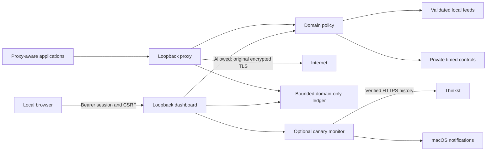

# Architecture and threat model

Remote sites and incoming proxy requests are untrusted. Blocked CONNECT requests must be refused before upstream contact. HTTP target authority is authoritative; an inconsistent Host header cannot turn a remote request into a loopback exemption. HTTPS tunnels remain opaque, including their authentication data. Port 443 does not prove TLS: while `block_plaintext_credentials` is on, an admitted tunnel to an external host must begin with a complete TLS ClientHello (at most 32 KiB over 32 reads); anything else closes the client connection before the lazy upstream connection opens. The ClientHello is parsed, not terminated or re-signed.

The dashboard admits only its exact loopback Host/Origin. The native launcher and server authenticate each other using role-separated HMAC proofs bound to the exact origin and fresh client and server nonces. The install-specific key stays in a private file; the browser receives only a short-lived, one-use bootstrap. The resulting expiring bearer session is held in origin-scoped tab sessionStorage, never a cross-port cookie. Mutations also require a session-bound CSRF value. At most eight requests enter worker threads, with both idle and total request deadlines. The server serves three fixed static files and a small fixed action set. No control API changes native network settings or runs user-provided commands.

Local health replies have a two-second response deadline; each launcher exchange has a three-second response deadline, including after a reconnect. Both accept at most 4 KiB of JSON object data. Malformed replies fail cleanly; only a correctly shaped, authenticated bootstrap token can reach the browser launcher.

Feed files contain domain data rather than executable code. Every source has a fixed HTTPS URL, per-feed size and syntax requirements, minimum counts, shrink protection, an atomic last-good cache and local integrity metadata. Fresh retrieval and upstream publication time are distinct signals. CNAME data is exact-match only; wildcard-shaped records must not become parent-domain blocks.

After TCP/TLS connection establishment, feed responses have a 60-second deadline and canary-history responses have a 45-second deadline, covering headers and bodies. These limits supplement the 20-second feed and 15-second canary idle timeouts: a peer cannot keep a refresh or poll occupied by sending occasional bytes. Expiration uses the normal sanitized failure path, retains the last good feed or canary state, and releases the update lock. DNS resolution, connection establishment and TLS handshakes retain their OS/transport limits.

Public native activation is disabled in this release. A per-user process cannot retain ownership of its port across logout or an explicit service unload, while system proxy settings can outlive it. Inspection remains available, and receipt-based restoration compares current settings to this installation's settings before changing them. The retained private transaction implementation is exercised only through mocked macOS commands; it is not an activation interface.

Per-user background jobs and state are intentionally unprivileged. A local administrator or process already running as this user can interfere with them. The product does not parse every protocol, identify all applications reliably, prevent all data exfiltration or intercept ordinary HTTPS payloads.

## Decisions made for this release

The public edition excludes private corporate-agent inspection, broad certificate trust, machine-specific update installers and automatic account lockouts. It uses separate defaults and state paths from the local prototype. Installation does not change networking; users configure individual proxy-aware clients. Future machine-wide routing needs an OS-managed endpoint whose ownership is verified across boot, logout and service failure.
