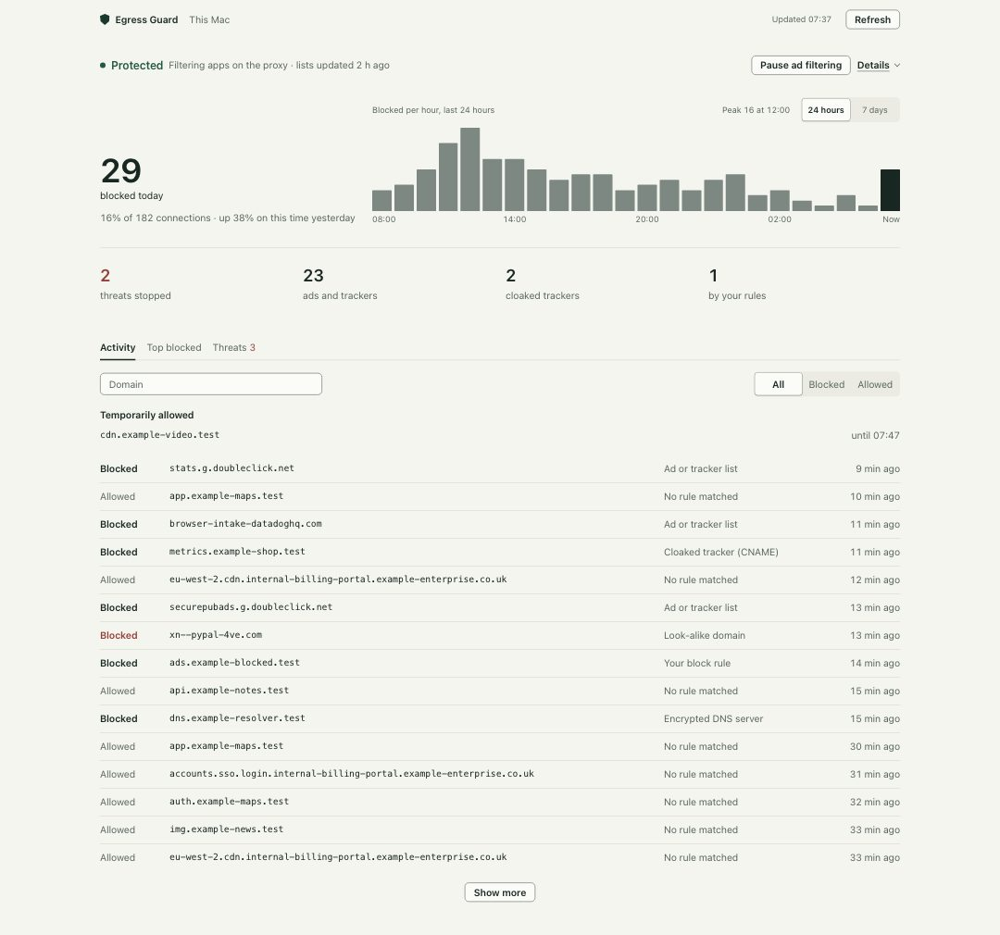

# Dashboard review

## Design-system rebuild (2026-11-21)

The 0.4 outcome dashboard is rebuilt on [docs/design](design/DESIGN.md): `app.css` begins with `tokens.css` byte for byte (a test fails on drift), and the page follows the dashboard mockup and the IA in DESIGN.md section 12.

- **Above the fold at 1440 × 900:** the status row (dot, state word, one fact, and the fixing action: Update lists, Pause ad filtering, or Resume filtering as the one filled button), blocked today in display size with its share and change against this time yesterday, a blocked-only 24-hour bar strip (7 days on the range control), and four reason metrics. A stopped threat's count, the Threats tab count and threat rows in Activity carry the threat colour; nothing else does.
- **Drill-down tabs:** Activity (search filters, Enter checks a domain, All/Blocked/Allowed, the row action appears on hover or focus and checks `/api/domain` before the confirm dialog), Top blocked (by reason, including threats, encrypted DNS servers, cloaked trackers and your rules, plus top domains), Threats.
- **Details:** a disclosure under the status row holds the proxy (with its memory and uptime when reported), block lists, canary alerts and setup checks. It opens by itself with numbered setup steps when protection is not running.
- **States:** new install, `aggregate` (UTC days, no hourly strip), `none` (how to turn history on; the domain check still works), and "No data before …" for periods the ledger never covered. Exact per-period counts stay reachable through the focusable bars and a hidden table; polls update the bars in place.

Captures: the real server and web assets with a seeded synthetic ledger (`.test` hostnames plus public tracker names) in a private temp state dir, through [`design/review/dashboard-harness.py`](design/review/dashboard-harness.py) and `node docs/design/review/capture.mjs live` (headless Chrome, CDP device metrics). The harness overlays a running-proxy status because the temp install has no proxy; "not protecting" is the real unmodified status. The audit reports 0 clipped elements, 0 overlaps, no horizontal scroll at 390, at most one filled button, and five type sizes on every capture (mockups included).

| State | Before (0.4) | After |
| --- | --- | --- |
| Populated, 1440 | [before](screenshots/before-full-1440-light.jpg) | [light](screenshots/after-full-1440-light.jpg) · [dark](screenshots/after-full-1440-dark.jpg) |
| Populated, 390 | [before](screenshots/before-full-390-light.jpg) | [light](screenshots/after-full-390-light.jpg) · [dark](screenshots/after-full-390-dark.jpg) |
| Populated, 768 | | [light](screenshots/after-full-768-light.jpg) |
| New install, not protecting, 1440 | [before](screenshots/before-empty-1440-light.jpg) | [light](screenshots/after-empty-1440-light.jpg) |
| New install, not protecting, 390 | [before](screenshots/before-empty-390-light.jpg) | [light](screenshots/after-empty-390-light.jpg) |
| Reduced (stale lists), 1440 | | [light](screenshots/after-reduced-1440-light.jpg) |
| Aggregate history, 1440 | | [light](screenshots/after-aggregate-1440-light.jpg) |
| History off, 1440 | | [light](screenshots/after-none-1440-light.jpg) |
| Top blocked tab, 1440 | | [light](screenshots/after-top-1440-light.jpg) |
| Threats tab, 390 | | [dark](screenshots/after-threats-390-dark.jpg) |

## 0.4 outcome dashboard (2026-11-20)

The 0.3 dashboard was a status checklist: equal-weight cards, a column of "Needs attention" pills and no numbers. It never answered "what did this block for me today?". The redesign leads with that answer and folds health into one line.

What changed, top to bottom:

- **Health line.** One calm sentence when everything is fine ("Protected · policy applied · feeds updated 2 h ago"). Stale feeds turn the dot amber and are named in the line. When protection is not running the line turns red, the detail panel opens by itself and numbered setup steps appear. A proxy footprint (memory, uptime) joins the line only when the proxy reports it.
- **Blocked today.** One large number, its share of all connections, and the change against the same elapsed time yesterday. Malware and phishing stops get their own red callout with the hostnames. A week with none says so in one quiet line.
- **Timeline.** Stacked hourly (24 h) or daily (7 d) bars, blocked at the base. Hover or arrow keys give exact counts. A hidden table carries the same data for screen readers.
- **What was blocked.** Counts by reason (malware and phishing, ads and trackers, cloaked CNAME trackers, your block rules) and the top blocked domains, both following the time range.
- **Activity.** A hostname list in mono with decision, plain-language reason, relative time and a row action (Allow…, Block…, Unblock…) that checks policy first. The search field filters as you type; Enter runs the domain check.

Every figure comes from `GET /api/insights`, which reads the local ledger read-only. The proxy only sees hostnames, so the page never shows bytes or time saved. History modes have their own states: `full` (everything above), `aggregate` (UTC-day totals, no hourly chart, per-day activity tallies) and `none` (says history is off and how to turn it on; the domain check still works).

Captures use isolated temp state and a synthetic ledger: `.test` hostnames plus well-known public tracker hostnames. No real browsing data appears.

Its captures are superseded; the 0.4 page appears as "Before" in the section above.

## 0.3 release

These captures use isolated, empty local state. Missing feeds, an inactive proxy and unregistered optional canaries are reported directly. No real traffic, credentials or device status appear in them.

| Width | Initial package | Release |
| --- | --- | --- |
| 390 px | [Before](screenshots/before-390.jpg) | [After](screenshots/first-run-390.jpg) |
| 1440 px | [Before](screenshots/before-1440.jpg) | [After](screenshots/first-run-1440.jpg) |

Both widths fit without horizontal scrolling. The release states per-application scope, gives explicit setup/recovery guidance, and explains that canaries are optional. The isolated browser flow exercised hostname lookup, manual block confirmation and removal. Native browser input became unreliable during the later phone control check; the phone layout and confirmation state were inspected, and HTTP/control regressions cover the mutations separately.

The initial-package render fixture permits top-level navigation to its public document, matching the release's narrow navigation fix. API requests retain their authentication and cross-site checks.
